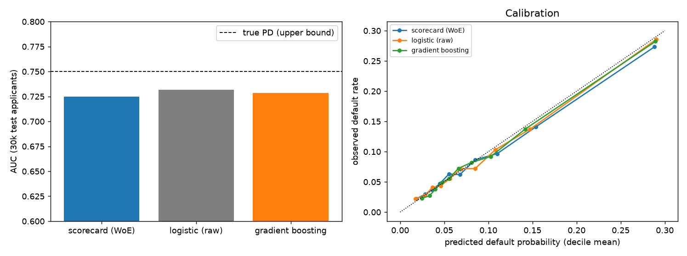
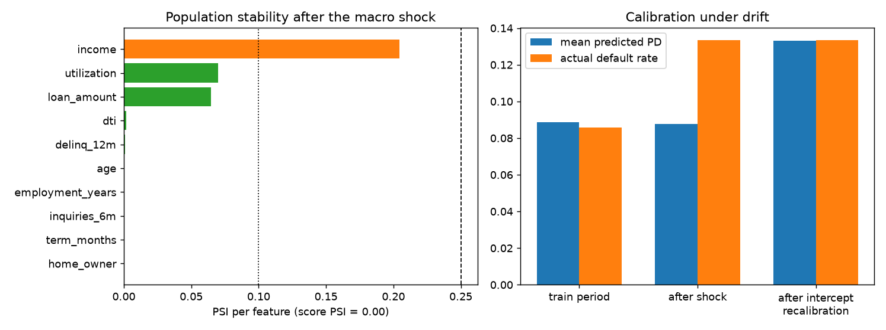
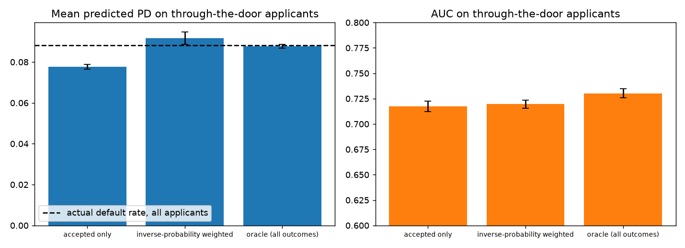
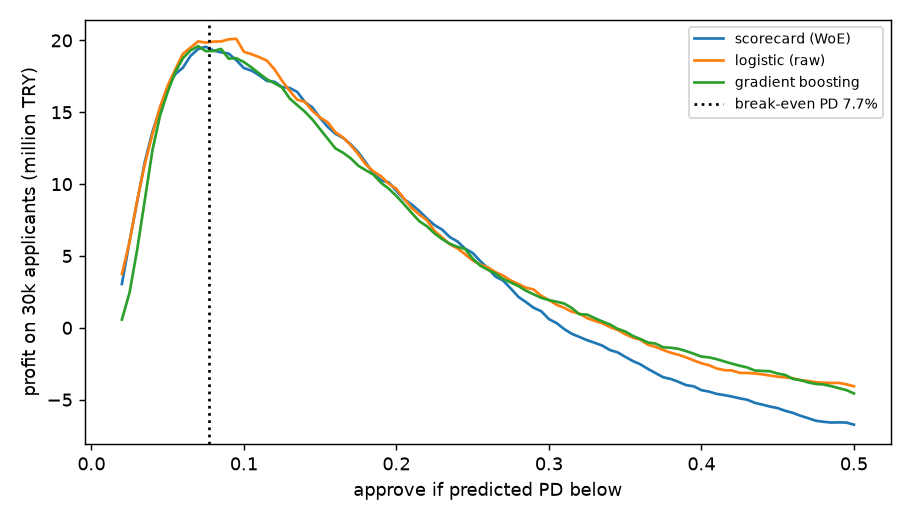

# Credit Scorecard: From WoE Bins to Drift and Reject Inference

A retail-lending **application scorecard** built the way banks build them (weight-of-evidence binning, information value, logistic regression, points scaling, reason codes), followed by the questions a **model-risk team** actually asks and most tutorials skip:

1. Does the interpretable scorecard give up accuracy against raw logistic regression and gradient boosting?
2. What happens after a **macro shock**, and what does monitoring catch?
3. The bank only sees outcomes for applicants it **approved**. How wrong is a model trained on those?
4. Where should the cutoff be, **in money**?

All data is synthetic, generated from a known default process (`true_pd`), which makes it possible to compare against the *best achievable* model and against the oracle that saw every applicant's outcome.



## The scorecard

- **WoE binning** with monotonic merging (risk bands that only go one way), a separate bin for missing values (they are informative here), and rare-category pooling. Age is deliberately left non-monotone: risk is U-shaped.
- **Variable selection by IV** (≥ 0.02): `dti` 0.36, `income` 0.15, `utilization` 0.12, `delinq_12m` 0.11, `loan_amount` 0.11, `age` 0.10 ... `inquiries_6m` (0.013) is dropped.
- **Points**: 600 points = 50:1 good:bad odds, 20 points double the odds. The score is a sum of per-bin points, so every decision can be explained with **reason codes**. Example: a declined applicant with 3 delinquencies, DTI 0.65 and a missing utilization field lost 29 points on delinquencies, 25 on DTI and 15 on the missing field.

## 1. Accuracy cost of interpretability (30,000 test applicants)

| Model | AUC | Gini | KS | Brier |
|---|---|---|---|---|
| Scorecard (WoE) | 0.725 | 0.450 | 0.328 | 0.0727 |
| Logistic (raw) | 0.732 | 0.463 | 0.342 | 0.0712 |
| Gradient boosting | 0.729 | 0.457 | 0.331 | 0.0715 |
| *True PD (upper bound)* | *0.750* | *0.500* | *0.366* | *0.0700* |

The scorecard gives up about **0.7 AUC points** against the best model, and gradient boosting is not better than plain logistic regression. The simulator's default process is close to additive, which favours linear models; real portfolios with stronger interactions often show a larger gradient-boosting advantage.

## 2. Macro shock: what monitoring sees and what it misses

The later vintage has higher defaults (8.6% → 13.4%), income inflation and bigger loans.



- All three models keep their **ranking** (AUC unchanged at 0.725-0.732) but predict an average PD of 8.8% against an actual 13.4%: **badly under-calibrated**, which would flow straight into provisions and pricing.
- **The score PSI was 0.0004, i.e. "perfectly stable".** Income drifted (PSI 0.20, "watch"), but the points gained from higher income cancelled the points lost to higher utilisation and loan size. PSI monitors the *inputs*; the macro shock changed P(default | inputs), which input monitoring cannot see. Only comparing predicted with realised default rates catches it. The exact cancellation is a coincidence of the chosen parameters, the principle is not.
- Re-fitting the intercept on 5,000 recent applicants restores the mean PD (13.3% vs 13.4% actual) and leaves AUC untouched. This works so cleanly because the simulated shock *is* an intercept shift; a shock that changes how variables matter would need a refit.

## 3. Reject inference

The legacy policy approves 70% of applicants (97% of those passing its rules, 12% of the others through overrides). A model trained only on approved applicants has seen a **truncated population**: their default rate is 6.2% against 8.8% for everyone. Models are scored on fresh *through-the-door* applicants, mean of 5 independent runs:

| Training data | AUC | Mean predicted PD (actual 8.8%) | Bad rate when approving the best 70% |
|---|---|---|---|
| Accepted only | 0.717 ± 0.005 | **7.8%** | 5.26% |
| Accepted, inverse-probability weighted | 0.720 ± 0.004 | **9.2%** | 5.18% |
| *Oracle: all outcomes (impossible in practice)* | *0.730 ± 0.004* | *8.8%* | *4.99%* |



- The accepted-only model **underestimates risk by 11%** and ranks worse than the oracle (paired AUC gap +0.013 in all 5 runs).
- **Inverse-probability weighting helps only a little**: paired AUC gain of +0.0023 on average (+0.002, -0.000, +0.002, +0.002, +0.006), about a sixth of the gap, and it *over*-corrects the level (9.2%). It is possible only because overrides give every applicant a non-zero chance of approval; under a strict rule it would be undefined.
- Takeaway: without outcomes for rejected applicants, calibration and ranking are both degraded, and cheap fixes recover little. Random approvals ("test and learn") are the real remedy.

## 4. Cutoff in money

Each repaid loan earns 2,500 TRY, each default loses 30,000 TRY, so the break-even PD is 7.7%. Cutoff chosen on one half of the test set, profit measured on the other half (15,000 applicants):

| Strategy | Approval rate | Profit (million TRY) |
|---|---|---|
| Scorecard (cutoff 7.0%) | 56% | 9.9 |
| Logistic (raw) (cutoff 9.5%) | 70% | 10.1 |
| Gradient boosting (cutoff 7.0%) | 58% | 10.1 |
| Legacy rule | ~70% | 6.9 |
| Approve everyone | 100% | -3.2 |



The three models are within noise of each other and earn about **45% more than the legacy rule**; approving everyone loses money. The profit curve is flat around its optimum, so the exact cutoff matters less than having a calibrated PD.

## Limitations

- Synthetic data with a near-additive default process and one tidy macro shock. Real credit data has multiple regimes, bureau data quirks, behavioural variables and policy changes.
- Reject inference compares two cheap methods only; parcelling, bureau-based inference and bounded-case methods are not covered.
- No fairness or adverse-impact analysis by protected group, which regulators require for production scorecards.
- The profit model uses fixed margins and losses; real loss given default depends on collateral and recoveries.

## Project structure

```
src/scorecard/
  data.py         # applicants with a known default process, two vintages, legacy approval policy with overrides
  woe.py          # weighted WoE binning, monotonic merging, IV
  scorecard.py    # logistic on WoE, points scaling, reason codes, intercept recalibration
  metrics.py      # AUC, Gini, KS, Brier, PSI, calibration table
  experiments.py  # the four experiments and all figures
tests/            # 13 tests: binning, scaling (PDO, base score), points = score, reason codes, recalibration, bias of accepted-only
```

## Quickstart

```bash
python -m venv .venv && source .venv/bin/activate
pip install -r requirements.txt
PYTHONPATH=src python -m scorecard.experiments
pytest
```

## Tech stack

Python · pandas · scikit-learn · SciPy · Matplotlib · pytest

---

### 🇹🇷 Türkçe özet

Bankaların kullandığı biçimde bir **kredi başvuru skor kartı** (WoE binleme, IV, lojistik regresyon, puan ölçeği, ret gerekçe kodları) ve model risk ekiplerinin sorduğu dört soru: yorumlanabilirliğin doğruluk maliyeti (yaklaşık 0,7 AUC puanı), makro şok sonrası izleme, yalnızca onaylanan başvuruların sonucunu görmekten gelen seçilim yanlılığı (reject inference) ve kâr bazında kesme noktası. Bulgular: şok sonrası modeller sıralamayı koruyor ama ortalama PD'yi %8,8 tahmin edip gerçeği %13,4 buluyor; **skor PSI'ı 0,0004 ile "kararlı" gösterdi**, çünkü PSI girdileri izler, P(temerrüt | girdi)'yi değil. Yalnızca kabul edilenlerle eğitilen model riski %11 düşük tahmin ediyor; ters olasılık ağırlıklandırma farkın yalnızca altıda birini kapatıyor. Kâr açısından üç model gürültü içinde eşit ve eski kural setinden yaklaşık %45 daha fazla kazandırıyor. Veriler sentetik.
